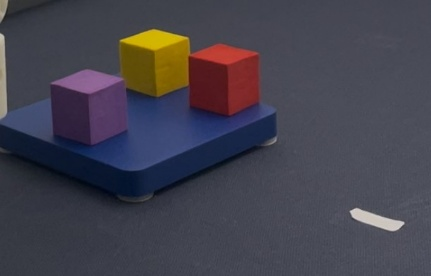
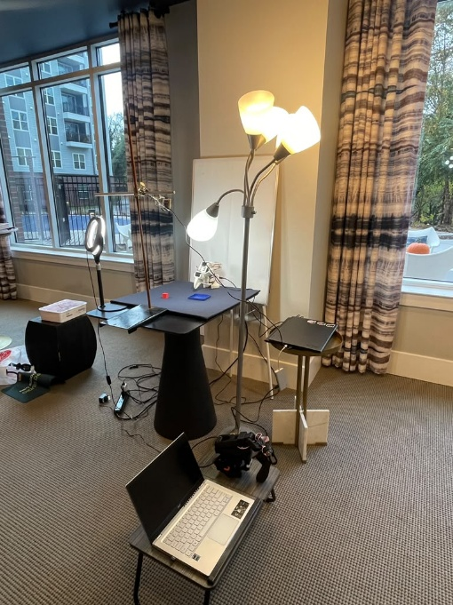
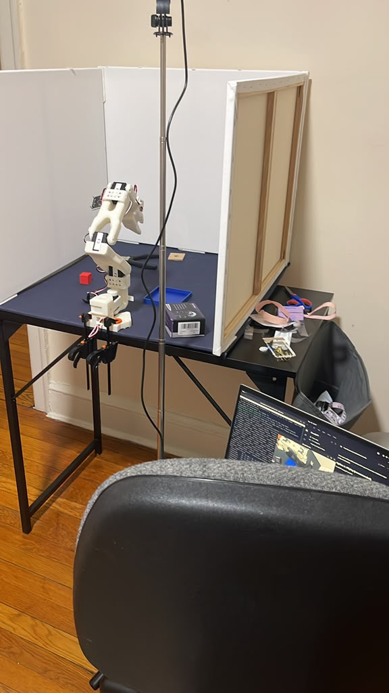
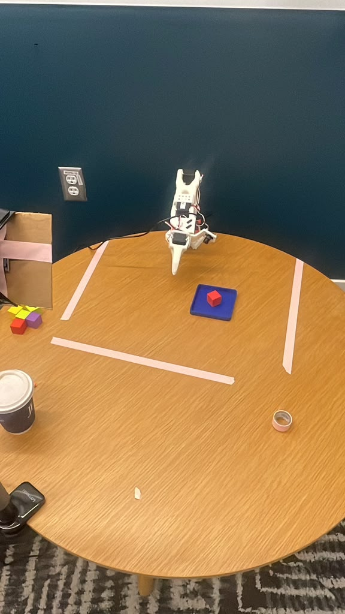
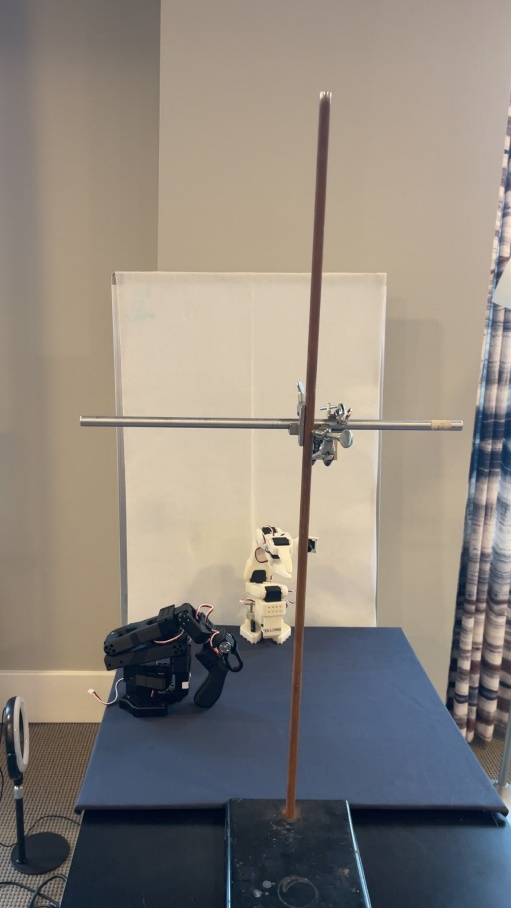

# Task 2 — Block stacking with a single-task ACT policy (SO-101)

*Team: Team 1*

## Policy rollouts

<table>
  <tr>
    <td align="center"><b>Rollout 1:</b> 3 blocks stacked</td>
    <td align="center"><b>Rollout 2:</b> 3 blocks stacked</td>
  </tr>
  <tr>
    <td><video src="PASTE_SUCCESS_1_LINK" controls muted width="400"></video></td>
    <td><video src="PASTE_SUCCESS_2_LINK" controls muted width="400"></video></td>
  </tr>
</table>


## Workspace



The policy is designed for a fixed, portable enclosure: blue base board, white canvas walls on three sides and a cloth top with its own light, so the background and illumination travel with the robot into the classroom. A tray with three slots (T1–T3) holds the red, yellow and purple cubes in a shuffled colour assignment; the tower is always built at a fixed white mark on the table in colour order red → yellow → purple. The only camera is the unchanged wrist camera (rotated −90° in software); there is no external camera, so no camera placement or calibration has to be reproduced.

## How the policy was trained

**Data:** 74 teleoperated demonstrations recorded (63 kept; LeRobotDataset v3, 30 fps), following a schedule that shuffles which slot each colour starts in and rotates the enclosure light through three colour settings every 5 episodes. Every demo performs all three placements, so each stage of the growing stack is covered; a fixed LOOK pose before each pick lets the wrist camera see the current stack height, giving the policy a stage cue. After testing showed failures on shifted cubes, 30 position-jitter demos (26 kept) were added.

**Policy:** ACT (chunk 50) trained 80k steps on the base demos (batch 32, image augmentation), then fine-tuned 20k steps on the merged 89-episode set (base + jitter, not jitter alone, to avoid forgetting the original positions) with the vision encoder unfrozen. A full retrain from scratch on the merged data was also run at the last minute; it was not evaluated, and the fine-tuned model worked well, so it was deployed (step 15k, temporal ensembling, coefficient 0.01). Diffusion Policy trained on the same data performed poorly on stacking and was not deployed.

## How it was tested

| Video | Outcome (blocks left stacked) | What happened |
|---|---|---|
| [success_1](videos/success_1.mp4) | 3 — success | Stacked well |
| [success_2](videos/success_2.mp4) | 3 — success | Stacked well |

A block counts only if it remains stacked after the arm withdraws.

Testing was informal: checkpoints were compared by running test rollouts on exact and shifted cube positions, and no systematic success counts were recorded — a limitation of this task. The in-class demonstration succeeded with the fine-tuned policy, so the planned fallback of collecting DAgger correction data in class was not needed.

## Sensitivity to changes in conditions

Intended variations: colour order (shuffled slots), cube position (jitter demos) and lighting (three light colour settings plus augmentation); background is held fixed by the enclosure. Testing before the demo showed the base policy generalized across colour orders but failed on cubes shifted from the nominal slots and under the yellow light setting (L2). The new data we captured and used to finetune our model addressed both these failures. We conducted controlled tests by changing one variable at a time on the fine-tuned model. Image augmentation (LeRobot) does not cover changes in camera pose; here the wrist camera never moves relative to the gripper.

## Failures observed

- Out of distribution configurations of cubes failed. Tried to arrange in a straight line, which was never done in training set - failed
- Placement errors accumulate up the stack, so the third placement failed when the second was unstable
- Adding more than 3 cubes confused the model.

## Limitations

No systematic evaluation: reliability is shown by a handful of recorded attempts, not success counts, and the retrain was never evaluated to the extent of Task1 – was driven by intuition.

The policy depends on the enclosure, a fixed stacking location and a fixed colour order; robustness to shifted cubes and to the yellow light setting (L2) was only partly addressed.

## Appendix — what carried over from Task 1

**Wrist camera only.** In Task 1, an external camera that shifted between sessions was the main source of failure we could not fully correct. For stacking, which had to transfer to the classroom, we dropped the external camera and used only the wrist camera, which moves with the gripper and cannot be displaced relative to it.

**Standardized teleoperation.** By the third Task 1 collection we had fixed teleoperation rules, and we kept them. Because the wrist camera sees much less of the workspace, every demonstration follows the same pattern: rise to a high LOOK pose to see the whole workspace and the current stack, pick the next cube, place it, rise again, and repeat until all three are stacked.

**Controlled environment.** As in Task 1's final round, the scene was constrained as much as possible: an enclosure with its own light provided the background and illumination, the tray slots and stacking mark were fixed, and the variation in the data (colour order, three light colour settings) was chosen deliberately and scheduled.

**Data added in stages.** The first dataset taught the policy to pick from three fixed positions with shuffled colours and stack in a fixed order. When testing showed failures on cubes shifted from those positions, we recorded a smaller set of demonstrations with cubes shifted horizontally beside the fixed positions, combined it with the first dataset, and fine-tuned the same ACT policy on all of it. Each round of data collection was driven by a specific observed failure, the same approach as in Task 1.

## Setup pictures

| | |
|---|---|
|  |  |
|  |  |

---

# HRL SO-101 — team setup (Assignment 2, Task 2)

Everything needed to run our SO-101 arm, trained policies and Task 2 scripts on another
Linux laptop with exactly the same software versions and robot calibration.

## What's in this repo

| Path | What |
|---|---|
| `env/` | Python, ffmpeg and PyTorch versions; `requirements-lock.txt` (exact pip versions); full conda export (reference) |
| `lerobot/` | Exact LeRobot commit + any local edits (`local_changes.patch`) |
| `calibration/` | Calibration JSONs for **our** arms (`so101_follower_vasco`, `so101_leader_vasco`) |
| `task2/` | `record_task2.sh`, `check_coverage.py`, collection schedule, demo log |
| `scripts/` | Other course scripts (Task 1 eval etc.) |
| `setup_teammate.sh` | One-shot setup |

**Not in git:** datasets and checkpoints live on the Hugging Face Hub (see below).

## Setup (once per laptop, ~15–20 min)

1. Install Miniforge if `conda` isn't available.
2. Clone and run:
   ```bash
   git clone git@github.com:<owner>/hrl-so101-bundle.git
   cd hrl-so101-bundle
   bash setup_teammate.sh
   ```
3. **Log out and back in** (serial-port permissions).
4. `conda activate lerobot` then `hf auth login` (token with read access; write if you'll push data).

The setup check should print `CUDA available: True`. If not, the NVIDIA driver is too old
for the PyTorch build in `env/torch_info.txt` — update the driver.

## Rules that matter

- **Never re-run calibration** on these arms. The policies were trained on actions recorded
  with this calibration; recalibrating shifts every joint and breaks them. Always use
  `--robot.id=so101_follower_vasco` and `--teleop.id=so101_leader_vasco` so the copied files are used.
- **Wrist camera only, rotated −90°, size given AFTER rotation** — use this exact line everywhere
  (record, rollout, DAgger):
  ```
  --robot.cameras="{ wrist: {type: opencv, index_or_path: /dev/videoN, width: 480, height: 640, fps: 30, fourcc: MJPG, rotation: -90}}"
  ```
- Leader arm = **5 V** adapter, follower = **12 V**. Never swap them.
- CLI is `hf`, not `huggingface-cli`.
- Run policies on the GPU (`--policy.device=cuda`). CPU inference stalls the control loop.

## First run on a new laptop

```bash
conda activate lerobot
lerobot-find-port                 # unplug/replug each arm's USB when asked
v4l2-ctl --list-devices           # find the wrist camera's /dev/videoN
```

Lock camera exposure/white balance (control names vary by camera — list them first):
```bash
v4l2-ctl -d /dev/videoN --list-ctrls
v4l2-ctl -d /dev/videoN -c auto_exposure=1 -c white_balance_automatic=0
```

Teleop test (both arms connect, follower tracks leader smoothly):
```bash
lerobot-teleoperate \
  --robot.type=so101_follower --robot.port=/dev/ttyACM_FOLLOWER --robot.id=so101_follower_vasco \
  --robot.cameras="{ wrist: {type: opencv, index_or_path: /dev/videoN, width: 480, height: 640, fps: 30, fourcc: MJPG, rotation: -90}}" \
  --teleop.type=so101_leader --teleop.port=/dev/ttyACM_LEADER --teleop.id=so101_leader_vasco \
  --display_data=true
```
If it asks to calibrate, the calibration files weren't found — stop and check
`~/.cache/huggingface/lerobot/calibration/` instead of calibrating.

On Wayland, LeRobot's keyboard shortcuts (→ end episode, Esc stop) only work while the
terminal running it is focused.

## Data and checkpoints (Hugging Face Hub)

- Dataset: `shilpitha-03/so101_stack_rpy` — 74 episodes, **63 kept**. Always train with:
  ```
  --dataset.episodes="[2,3,4,7,8,9,11,12,13,14,15,16,17,18,19,20,21,22,23,24,25,26,27,28,30,31,32,33,34,35,36,37,38,39,42,43,44,45,46,47,48,49,50,51,52,53,56,57,58,59,60,61,62,63,64,65,67,68,69,70,71,72,73]"
  ```
- Upload a checkpoint (from the machine that trained it):
  ```bash
  hf upload shilpitha-03/act_stack_c50 outputs/act_stack_c50/checkpoints/last/pretrained_model . --repo-type model --private
  ```
- Download on the robot laptop:
  ```bash
  hf download shilpitha-03/act_stack_c50 --local-dir checkpoints/act_stack_c50
  ```

## Running a policy (rollout)

```bash
lerobot-rollout \
  --policy.path=checkpoints/act_stack_c50 \
  --policy.device=cuda \
  --robot.type=so101_follower --robot.port=/dev/ttyACM_FOLLOWER --robot.id=so101_follower_vasco \
  --robot.cameras="{ wrist: {type: opencv, index_or_path: /dev/videoN, width: 480, height: 640, fps: 30, fourcc: MJPG, rotation: -90}}" \
  --fps=30 --dataset.fps=30 \
  --strategy.type=episodic \
  --dataset.repo_id=shilpitha-03/rollout_task2_act_c50 \
  --dataset.single_task="Stack the red, yellow and purple cubes on the table mark" \
  --dataset.num_episodes=10 --dataset.episode_time_s=100 --dataset.reset_time_s=30
```
Temporal ensembling (worked best for gripper timing in Task 1): add
`--policy.n_action_steps=1 --policy.temporal_ensemble_coeff=0.01`.

Log every rollout: color arrangement, success, failure stage
(wrong cube / grasp / placement 1-2-3 / release / froze at LOOK).

## DAgger (human-in-the-loop corrections)

```bash
lerobot-rollout --strategy.type=dagger \
  --policy.path=checkpoints/act_stack_c50 --policy.device=cuda \
  --robot.type=so101_follower --robot.port=/dev/ttyACM_FOLLOWER --robot.id=so101_follower_vasco \
  --robot.cameras="{ wrist: {type: opencv, index_or_path: /dev/videoN, width: 480, height: 640, fps: 30, fourcc: MJPG, rotation: -90}}" \
  --teleop.type=so101_leader --teleop.port=/dev/ttyACM_LEADER --teleop.id=so101_leader_vasco \
  --dataset.repo_id=shilpitha-03/stack_hil \
  --dataset.single_task="Stack the red, yellow and purple cubes on the table mark" \
  --dataset.fps=30 --strategy.num_episodes=25
```
Keys: `Space` pause/resume policy · `Tab` start/stop your correction (only while paused) · `Esc` stop.
Correction: lift to a clean hover, finish that one pick/placement, release, lift straight up,
return to the LOOK pose, then hand back. If the stack has already collapsed, end and reset.

Merge and fine-tune (rollout adds a timestamp to the dataset name):
```bash
lerobot-edit-dataset --repo_id shilpitha-03/stack_hil_YYYYMMDD_HHMMSS \
  --new_repo_id shilpitha-03/stack_hil_clean \
  --operation.type remove_feature --operation.feature_names "['intervention']"
lerobot-edit-dataset --new_repo_id shilpitha-03/stack_plus_hil1 \
  --operation.type merge \
  --operation.repo_ids "['shilpitha-03/so101_stack_rpy', 'shilpitha-03/stack_hil_clean']"
```
Merging re-numbers episodes: rebuild the kept list (63 original kept + all HIL episodes) before
fine-tuning from `checkpoints/act_stack_c50` for ~15–20k steps.

## Recording more demos

```bash
cd task2
bash record_task2.sh      # edit ports/camera at the top first
python3 check_coverage.py
```
